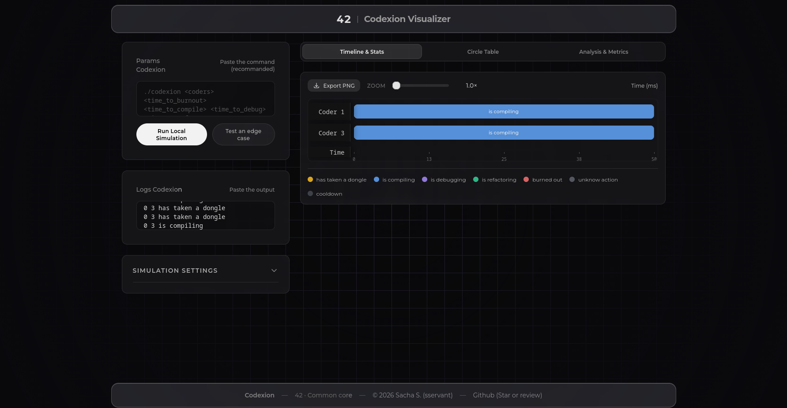

<div align="center">


# Codexion Visualizer

**Debug, validate and share your 42 Codexion scheduler, one timeline at a time.**

[](https://github.com/0xS4cha/codexion_visualizer/actions/workflows/ci.yml)
[](LICENSE)
[](https://codexion-visualizer.sacha-dev.me/)


[**Live demo**](https://codexion-visualizer.sacha-dev.me/) · [Edge Case Hub](https://codexion-visualizer.sacha-dev.me/hub) · [Report a bug](https://github.com/0xS4cha/codexion_visualizer/issues) · [Contribute](https://github.com/0xS4cha/codexion_visualizer/pulls)



</div>

---

## Table of contents

- [Overview](#overview)
- [Features](#features)
- [Quick start](#quick-start)
- [Feeding the visualizer](#feeding-the-visualizer)
- [Tech stack](#tech-stack)
- [Architecture](#architecture)
- [API reference](#api-reference)
- [Configuration](#configuration)
- [Testing & quality](#testing--quality)
- [Deployment](#deployment)
- [Contributing](#contributing)
- [License](#license)

## Overview

Codexion is a 42 Common Core project in which coders share dongles under a scheduler (FIFO or EDF) and must compile, debug and refactor without burning out. Reading thousands of log lines to find *why* a coder burned out is slow, so this tool does it for you:

- it **renders** your program's log as an interactive timeline and a live circle table;
- it **validates** the log against the subject's rules and points to the exact line that breaks them;
- it **compares** your run with a reference simulation and shows where the two first diverge;
- it **builds a community** of edge cases that every student can replay against their own implementation.

Everything runs in the browser. Your command, log and settings are kept locally and are only sent to the server when you choose to share them.

## Features

### Visualization

| View | What it gives you |
| --- | --- |
| **Timeline** | Canvas renderer that scales to very large logs. Zoom (<kbd>Ctrl</kbd>/<kbd>⌘</kbd> + wheel), pan (drag, <kbd>Shift</kbd> + wheel), burnout deadline markers, issue markers and a shared time cursor with playback (play/pause, speed, step by event). |
| **Circle Table** | Coders and dongles at the cursor time, synchronized with the timeline. |
| **Analysis & Metrics** | Log validator plus per-coder metrics: waits, burnout margin, dongle hold time, fairness. Click an issue to jump to it on the timeline. |
| **Compare** | Your log against the reference simulation, with the first divergence highlighted. |

### Log validator

The analyzer catches parse errors, out-of-order timestamps, logs after a burnout, invalid coder ids, dongle conflicts, invalid state transitions, wrong durations, cooldown violations, early/late/missed burnouts, incomplete runs and possible FIFO/EDF violations.

### Sharing & export

- **Short links** (`/r/:id`) stored server side, with compressed `?share=` links as a fallback.
- **Exports**: timeline PNG, segments CSV, issues CSV, full analysis JSON and the raw log.

### Edge Case Hub

Logged in with your 42 account, you can:

- publish edge cases (command, settings, tags and optionally your log);
- vote, comment, search, filter by tag and sort (newest, top voted, most discussed, oldest);
- **Open** a case to run it with your program, **Replay** the author's log, or **Check my log** against it;
- browse contributor profiles at `/u/:login`.

### Global reach

`/world` is a live dashboard of where the visualizer is used: choropleth world map, cities, KPIs, referrers, browsers, devices and community activity, with period filters, a PNG snapshot and deep links.

## Quick start

### Prerequisites

- **Node.js 22+** and npm
- The [Vercel CLI](https://vercel.com/docs/cli) if you want to run the API routes locally
- A Firebase project and a [42 API application](https://profile.intra.42.fr/oauth/applications) for the authenticated features

### Install & run

```bash
git clone https://github.com/0xS4cha/codexion_visualizer.git
cd codexion_visualizer
npm install
cp .env.example .env    # then fill in the values, see Configuration
```

| Command | Description |
| --- | --- |
| `npm run dev` | Front end only (Vite). Visualizer, reference simulation and live mode work without any backend. |
| `npm run vercel` | Front end **and** serverless API on `http://localhost:3000` (hub, sharing, stats, 42 login). |
| `npm run build` | Type-check and production build into `dist/`. |
| `npm run preview` | Serve the production build locally. |
| `npm test` | Run the unit test suite (Vitest). |
| `npm run lint` | Lint the codebase (ESLint). |

## Feeding the visualizer

There are four ways to load a run:

1. **Command**: paste it, fill in the **Form**, pick a **Preset** or **Randomize** edge-case parameters.
2. **Log**: paste it, drop a `.log` / `.txt` file on the log panel, or import it. A command on the first line is detected automatically.
3. **Reference simulation**: generate a log locally with the built-in simulator.
4. **Live mode**: stream your program in real time with [codexion_live](https://github.com/0xS4cha/codexion_live):

   ```bash
   ./codexion_live -- ./codexion 4 800 200 200 200 5 0 fifo
   ```

   The visualizer connects to `ws://127.0.0.1:8080` by default and can rerun your program from the UI.

## Tech stack

| Layer | Technologies |
| --- | --- |
| **Front end** | React 19, TypeScript, Vite, React Router 7, Redux Toolkit |
| **UI** | Tailwind CSS 4, shadcn/ui (Radix), Motion, Lucide icons |
| **Data viz** | Custom canvas timeline, Recharts, MapLibre GL |
| **Backend** | Vercel serverless functions (Node.js), Firebase Admin |
| **Data & auth** | Cloud Firestore, Firebase Auth (custom tokens), 42 OAuth |
| **Tooling** | Vitest, ESLint, Knip, GitHub Actions |

## Architecture

```text
.
├── api/                     # Vercel serverless functions
│   ├── _utils/              # Firebase Admin, CORS, auth, rate limiting, validation, stats
│   ├── cases/               # Edge Case Hub: save, vote, comments
│   ├── login.ts, callback.ts# 42 OAuth flow → Firebase custom token
│   └── pulse.ts, stats.ts, runs.ts, visit.ts
├── src/
│   ├── core/                # Pure logic: log parser, validator, metrics, comparison, simulation (+ worker)
│   ├── components/Codexion/ # Feature components (timeline, table, analysis, hub, world)
│   ├── components/ui/       # shadcn/ui primitives and visual effects
│   ├── pages/               # Route-level pages (lazy loaded)
│   ├── store/               # Redux slices (input, settings, view) + local persistence
│   ├── hooks/, lib/         # Data hooks, share links, exporters, analytics
│   └── config/              # Firebase client, tags, legal content
├── scripts/                 # Python scraper listing READMEs that link to the visualizer
└── .github/workflows/       # CI and the daily community refresh
```

**Design principles**

- **Pure core**: everything in `src/core` is framework-free and unit tested. The UI only renders what the core computes.
- **Off the main thread**: log parsing and analysis run in a Web Worker so the UI stays responsive on large logs.
- **Local first**: visualizing, validating and simulating need no backend. The API only powers sharing, the hub and statistics.

### Routes

| Path | Page |
| --- | --- |
| `/` | Visualizer |
| `/hub` | Edge Case Hub (requires 42 login) |
| `/world` | Global usage dashboard |
| `/community` | Students who link the visualizer in their READMEs |
| `/r/:id` | Shared run |
| `/u/:login` | Contributor profile |
| `/login`, `/terms`, `/privacy` | Authentication and legal pages |

## API reference

All routes live under `/api`. Write routes validate their payloads (sizes, tags, command format) and are rate limited per IP or per user.

| Route | Methods | Auth | Rate limit | Purpose |
| --- | --- | --- | --- | --- |
| `/login` | `GET` | | | Redirects to 42 OAuth |
| `/callback` | `GET` | | | Exchanges the 42 code and issues a Firebase custom token |
| `/protected-route` | `GET` `POST` | ✓ | | Verifies the current session |
| `/runs` | `GET` `POST` | | 120/min read · 20/h write per IP | Short share links |
| `/cases/save` | `POST` | ✓ | 5/h per user | Publish an edge case |
| `/cases/vote` | `POST` | ✓ | 60/min per user | Up/down vote |
| `/cases/comments` | `GET` `POST` `DELETE` | ✓ for writes | 120/min read · 10/min write | Edge case comments |
| `/visit` | `POST` | | 30/min per IP | Anonymous visit analytics |
| `/stats` | `GET` | | | Aggregated statistics for `/world` |
| `/pulse` | `GET` | | | Lightweight home data: live visitors, countries, GitHub repo, top edge cases |

## Configuration

Copy `.env.example` to `.env` and fill in:

| Variable | Scope | Description |
| --- | --- | --- |
| `FORTY_TWO_CLIENT_ID` / `FORTY_TWO_CLIENT_SECRET` | Server | 42 API application credentials |
| `FORTY_TWO_REDIRECT_URI` | Server | OAuth callback, e.g. `http://localhost:3000/api/callback` |
| `FIREBASE_PROJECT_ID` / `FIREBASE_CLIENT_EMAIL` / `FIREBASE_PRIVATE_KEY` | Server | Firebase Admin service account |
| `VITE_FIREBASE_*` | Client | Firebase web app config (API key, auth domain, project id, storage bucket, sender id, app id) |
| `GITHUB_TOKEN` | Server | Optional. Raises the GitHub API limit for repo stats |
| `ALLOWED_ORIGINS` | Server | Comma-separated origins that receive CORS headers (`*` allowed) |
| `DEV_COUNTRY` | Server | Optional. Country code used for analytics when no Vercel geo header is present (local dev) |

> [!IMPORTANT]
> Never commit `.env`. Variables prefixed with `VITE_` are bundled into the client and must not contain secrets.

## Testing & quality

```bash
npm test          # Vitest unit tests (parser, validator, metrics, compare, share links, stats)
npm run lint      # ESLint
npm run build     # Strict TypeScript check + production build
```

The [CI workflow](.github/workflows/ci.yml) runs lint, tests and build on every push to `main` and on every pull request. A [scheduled workflow](.github/workflows/users.yml) refreshes the community list every day at 06:00 UTC.

## Deployment

The project is built for **Vercel**:

1. Import the repository in Vercel. The Vite framework preset is detected automatically.
2. Add the environment variables from [Configuration](#configuration), and set `FORTY_TWO_REDIRECT_URI` to your production domain.
3. Deploy. Serverless functions run in the `cdg1` region (see [`vercel.json`](vercel.json)), and every non-API route is rewritten to the SPA.

## Contributing

Contributions are welcome, whether it's a new validator rule, a UI improvement or a bug report.

1. Fork the repository and create a branch: `git checkout -b feat/my-feature`.
2. Make your changes and keep `npm run lint && npm test && npm run build` green.
3. Use [Conventional Commits](https://www.conventionalcommits.org/) (`feat:`, `fix:`, …).
4. Open a pull request describing the change and how you tested it.

Please read the [Code of Conduct](CODE_OF_CONDUCT.md) before contributing. If the visualizer saved you time, a ⭐ on the repo helps a lot.

## License

Released under the [MIT License](LICENSE).

<div align="center">
<sub>Built by 42 students, for 42 students.</sub>
</div>
