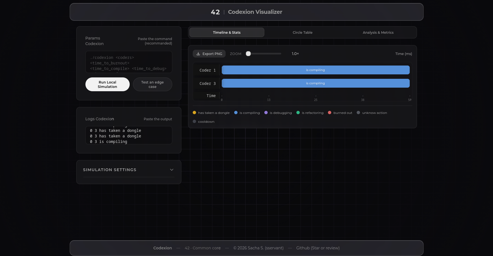

# Codexion - Visualizer

Codexion data visualization tool (TypeScript)

## Result

https://codexion-visualizer.sacha-dev.me/


## Description

This project is a TypeScript project focused on visualizing and exploring Codexion data through a clear, interactive interface. It has been created as part of the 42 curriculum (Codexion - Visualizer - 42 CC) to help inspect structures, debug datasets, and present information in a more readable and navigable format.


## Instruction

The Codexion Visualizer can be run locally with a standard Node.js toolchain.

```bash
npm install
```

Then run it:

```bash
npm run dev
```

## Usage

### Local Development

```bash
npm run dev
```

### Build

```bash
npm run build
```

### Preview (if available)

```bash
npm run preview
```

### Data Input

- paste the command (or fill the **Form**, pick a **Preset**, or **Randomize** edge-case parameters),
- paste the log, drop a `.log`/`.txt` file on the log panel, or import it (a command on the first line is detected),
- run the built-in **reference simulation**,
- or stream your program live with [codexion_live](https://github.com/0xS4cha/codexion_live): `./codexion_live -- ./codexion 4 800 200 200 200 5 0 fifo`.

The command, log and settings are saved in your browser.

## Visualization

- **Timeline**: canvas rendering that scales to large logs, zoom (Ctrl/⌘ + wheel), pan (drag, Shift + wheel), burnout deadline markers, issue markers and a shared time cursor with playback (play/pause, speed, step by event).
- **Circle Table**: coders and dongles at the cursor time, synchronized with the timeline.
- **Analysis**: a log validator (parse errors, timestamp order, logs after a burnout, coder ids, dongle conflicts, invalid transitions, durations, cooldown, burnout delay/early/missed, incomplete run, possible FIFO/EDF violations). Click an issue to jump to it on the timeline. Plus per-coder metrics (waits, burnout margin, dongle hold time, fairness).
- **Compare**: your log against the reference simulation, with the first divergence highlighted.
- **Export**: timeline PNG, segments CSV, issues CSV and full analysis JSON; download the log.
- **Share**: short links (`/r/:id`) or compressed `?share=` links as a fallback.

## Community hub

Share edge cases, vote, comment, sort (newest, top voted, most discussed), replay the author's log, check your own log against an edge case, and browse profiles (`/u/:login`).

## Tests

```bash
npm test
npm run lint
```

## Configuration

API routes only send CORS headers to the origins listed in `ALLOWED_ORIGINS` (comma separated, `*` allowed). Writes are rate limited and validated (sizes, tags, command format).

## Feedback

If you have feedback, open an issue or contact the author.
